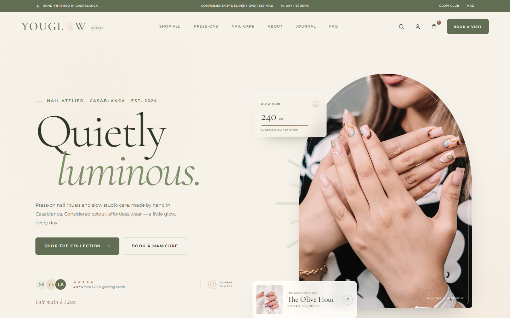

# YOUGLOW — Nail Atelier & Storefront

A complete, responsive multi-page storefront for **YOUGLOW**, a Casablanca nail atelier and press-on nail shop. Built with **Vue 3 + Vite + Vue Router**, with a quiet-luxury visual language based on the supplied references: sage green, warm cream, rose gold, editorial serif type and a sun motif.



## Run it

```bash
pnpm install
pnpm dev
```

Local preview: <http://127.0.0.1:5173/>

```bash
pnpm build       # production build in dist/
pnpm preview     # preview the production build
pnpm test        # requires `pnpm dev` running in another terminal
```

The test suite covers desktop navigation, shop filtering and sorting, quick view → product page, cart updates, search, booking, contact and newsletter forms, FAQ search, journal routing, legal pages, the 404 page and mobile dialogs.

## Pages

| Route | Page |
| --- | --- |
| `/` | Homepage |
| `/shop` | Shop collection, with category filters and sorting |
| `/product/:slug` | Product detail page |
| `/about` | About YOUGLOW / atelier story |
| `/faq` | Searchable FAQ with category filters |
| `/contact` | Contact form, studio details and map link |
| `/journal` | Journal index |
| `/journal/:slug` | Full journal article |
| `/privacy` | Privacy Policy |
| `/terms` | Terms of Service |
| `/shipping-returns` | Shipping & Returns |
| `/:pathMatch(.*)*` | Custom 404 page |

## What is included

- Editorial homepage with loyalty card, signature product card and social proof
- Routed shop with category filtering, price sorting and URL-synced filters
- Product detail pages with quantity, wishlist, add-to-bag, accordions and related products
- Working shopping bag drawer: quantity updates, remove, free-delivery progress, subtotal
- Instant search dialog linking into product quick views and full product pages
- Studio services with a validated appointment request flow
- About page with brand story, values, atelier photography and timeline
- Searchable FAQ with 19 answers across five categories
- Contact page with validated form, studio details, map link and contact channels
- Journal index and three full editorial articles with table of contents
- Privacy, Terms and Shipping & Returns pages with sticky on-page navigation
- Custom 404 with helpful routes back into the store
- Mobile navigation, sticky header and responsive layouts at 360/390/768/1024/1440 px
- Local fonts and images — no external CDN assets at runtime
- Keyboard-accessible dialogs, visible focus states, reduced-motion support and 4.5:1+ small text on dark grounds

## Demo boundaries

This is a **front-end storefront demo**, not a production commerce integration:

- Checkout is not connected to a payment provider. The button deliberately shows a demo message.
- Appointment requests, contact messages and newsletter subscriptions are validated in the browser and show local success states; nothing is sent to a server.
- Privacy, Terms and Shipping & Returns are **demonstration templates**, not legal advice. They are marked as templates in the UI and should be reviewed by a qualified professional before launch.
- Product imagery is demo stock photography, not final brand photography.

## Project structure

```text
src/
  App.vue                    app shell: header, routed main, footer, global overlays
  router.js                  routes, titles and scroll restoration
  styles.css                 global tokens, reset, typography, utilities
  fonts.css                  local font-face declarations
  pages/
    HomePage.vue             full editorial homepage
    ShopPage.vue             collection listing, filters and sorting
    ProductPage.vue          product detail, accordions and related pieces
    AboutPage.vue            brand story, values, atelier and timeline
    FaqPage.vue              searchable FAQ
    ContactPage.vue          contact form and studio information
    JournalPage.vue          journal index
    JournalArticlePage.vue   article template with table of contents
    LegalPage.vue            shared privacy / terms / shipping template
    NotFoundPage.vue         custom 404
  stores/shop.js             shared cart, wishlist, dialogs and toast state
  data/
    products.js              products, services, testimonials, journal articles
    legal.js                 privacy, terms and shipping copy
  components/
    BaseDialog.vue           accessible native <dialog> wrapper
    BookingDialog.vue        validated booking request flow
    BrandLogo.vue            serif wordmark + sun “O”
    CartDrawer.vue           cart drawer and empty state
    Icon.vue                 inline SVG icon set
    PageCta.vue              shared closing CTA band
    PageHero.vue             shared interior-page title and breadcrumbs
    ProductCard.vue          product card and wishlist/quick-add controls
    ProductVisual.vue        CSS packaging illustrations for the collection
    QuickViewDialog.vue      product preview with link to full detail page
    SearchDialog.vue         collection search
    SiteFooter.vue
    SiteHeader.vue
    SunMark.vue              reusable sun motif
public/
  fonts/                     self-hosted Cormorant Garamond + Montserrat
  images/                    optimized WebP editorial images
scripts/
  prepare_assets.py          image/font processing
  screenshots-pages.mjs      per-page screenshot capture
  test-ui.mjs                routed desktop interaction checks
  test-mobile.mjs            mobile dialog and navigation checks
  audit-pages.mjs            per-page accessibility and asset audit
  audit.mjs                  homepage performance/asset audit
design-system/youglow/MASTER.md
```

## Design tokens

| Token | Value | Use |
| --- | --- | --- |
| `--cream` | `#F7F2E9` | Primary page background |
| `--cream-soft` | `#FBF7F0` | Cards and raised surfaces |
| `--sand` | `#EBDFCD` | Campaign and newsletter bands |
| `--sage` | `#7C8E67` | Light green — large display accents, botanical surfaces |
| `--sage-deep` | `#616E54` | Dark green — primary CTA and dark section grounds |
| `--sage-dark` | `#616E54` | Alias of the dark brand green |
| `--sage-press` | `#4F5A44` | Hover/pressed interaction shade |
| `--rose` | `#BF8D76` | Rose-gold decorative accent |
| `--rose-deep` | `#925E4A` | Accessible rose text accent |
| `--ink` | `#2F372C` | Primary text |
| `--ink-soft` | `#5F6858` | Supporting text |
| `--ink-faint` | `#68705E` | Small labels (4.5:1+ on cream) |

Typography: **Cormorant Garamond** for display, **Montserrat** for UI. Arabic uses a system Arabic stack.

## Hosting note

The app uses HTML5 history routing. When deploying to a static host, add an SPA fallback that serves `index.html` for unknown paths (for example a `_redirects` rule on Netlify, a rewrite on Vercel, or a GitHub Pages `404.html` redirect). Vite’s `base` must also match the deployment subpath if the site is not served from `/`.

## Asset notes

Photography is sourced from Unsplash and Pexels for this design demo and optimized to local WebP files. See [CREDITS.md](CREDITS.md) for sources. Replace with commissioned YOUGLOW photography before production. Fonts are self-hosted from Google Fonts (SIL Open Font License).

Tested in Chromium with Playwright across 12 routes and five breakpoints. No browser console errors, no broken images, no unnamed interactive controls and no horizontal overflow at 360, 390, 768, 1024 and 1440 px.
